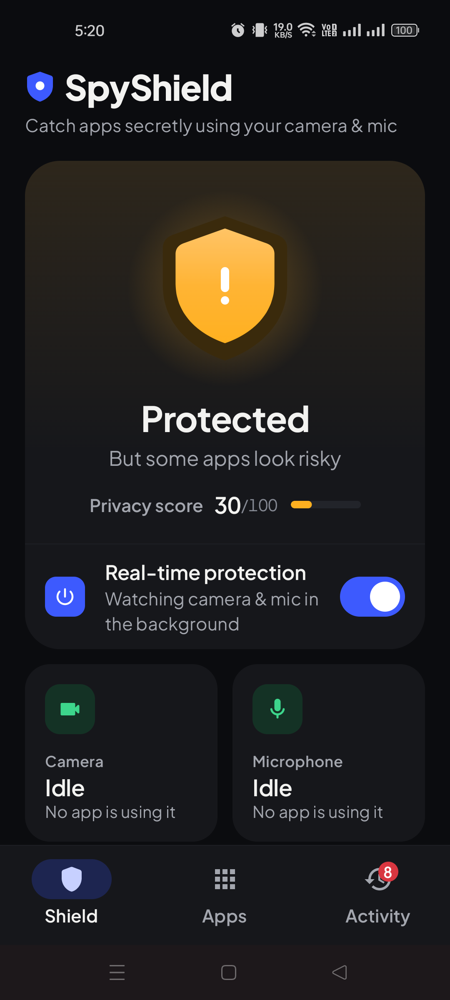
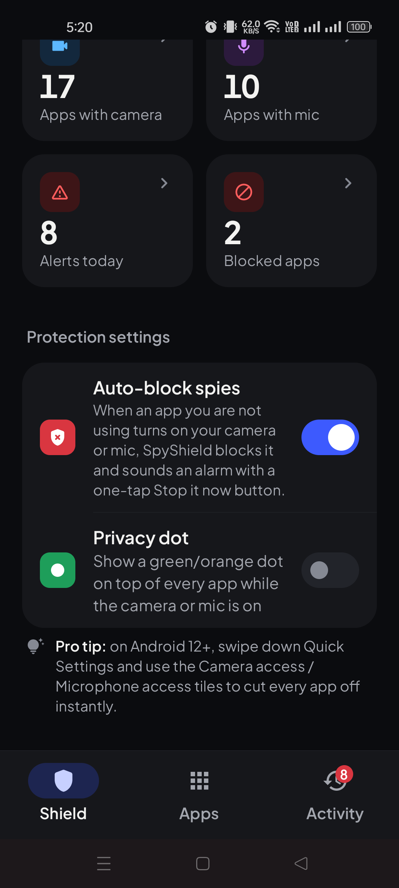

# SpyShield: see which app is using your camera and microphone

**A free, open-source Android app that tells you which app is using your camera or microphone, warns you when it happens in the background, and gives you one-tap shortcuts to deal with apps that may be spying on you.**

[](LICENSE)
[](#install-on-your-phone-step-by-step)
[](https://github.com/OWNER_PLACEHOLDER/spyshield/releases/latest)
[](https://github.com/OWNER_PLACEHOLDER/spyshield/releases)

<p align="center">
  <a href="https://github.com/OWNER_PLACEHOLDER/spyshield/releases/latest/download/SpyShield.apk">
    
  </a>
</p>

<p align="center">
  <b><a href="https://github.com/OWNER_PLACEHOLDER/spyshield/releases/latest/download/SpyShield.apk">Download SpyShield.apk (latest version)</a></b>
  &nbsp;·&nbsp; <a href="docs/INSTALL.md">Simple install guide</a>
  &nbsp;·&nbsp; <a href="https://OWNER_PLACEHOLDER.github.io/spyshield/">Website</a>
  &nbsp;·&nbsp; <a href="https://github.com/OWNER_PLACEHOLDER/spyshield/releases/latest">Release notes</a>
</p>

<p align="center">
  
  &nbsp;&nbsp;
  
</p>

---

## Contents

- [Why SpyShield](#why-spyshield)
- [Features](#features)
- [Install on your phone (step by step)](#install-on-your-phone-step-by-step)
- [First-time setup](#first-time-setup)
- [How to update](#how-to-update)
- [FAQ](#faq)
- [Honest limitations](#honest-limitations)
- [Privacy](#privacy)
- [For developers](#for-developers)
- [Contributing](#contributing)
- [License](#license)

---

## Why SpyShield

Ever wondered **"which app is using my camera?"** or **"which app is using my microphone right now?"** Android shows a small green dot, but it disappears in a second and it doesn't keep a history. It also won't tell you when an app switched the mic on while your phone was locked in your pocket.

SpyShield is a **camera and microphone access monitor** for Android. It watches in the background, names the app that turned a sensor on, and raises the alarm when something uses your camera or mic while you aren't looking. If you're worried your phone is being spied on, by stalkerware or just by an over-curious app, SpyShield shows you what happened and gives you one-tap shortcuts to deal with it.

It's free, has no ads and no account, and everything stays on your phone.

## Features

**Live camera and microphone monitoring**
- Get a notification the moment your camera or microphone turns on, with the name of the app using it.
- A live status in your notification shade shows whether the camera and mic are idle or in use.

**Alerts for hidden and background spying**
- Warns you when the camera or mic is used while the **screen is off**, while the **phone is locked**, or while you're on the **home screen**.
- On Android 10 and newer it also catches **background recordings that Android silenced**, a common sign of an app trying to listen in secretly.

**App scanner with a spy-risk score**
- Lists every installed app that can reach your camera or microphone and gives each one a **spy-risk score from 0 to 100**.
- Every score comes with plain reasons, for example: installed from outside a trusted store, starts itself at boot, can keep the camera or mic running in the background, not opened in 30+ days but still has access, or past suspicious use.
- **Pre-installed apps** that came with camera or mic access already granted by the phone maker are flagged too.

**Block, revoke, force stop, uninstall**
- Put an app on your **block list** and SpyShield sounds an instant, high-priority alarm the second it touches your camera or mic.
- One-tap **Revoke access**, **Force stop** and **Uninstall** buttons take you straight to the right Android screen.

**Optional Auto-block (off by default)**
- When an app you're *not* using turns on your camera or mic and SpyShield is confident which app it is, Auto-block adds it to your block list and sounds an alarm with a big **Stop it now** button.
- Tapping **Stop it now** opens the app's info page, where you tap **Force stop**. (Android doesn't let one app kill another, so this final tap is yours.)

**Fewer false alarms**
- Mark apps you trust so they never trigger alerts.
- Normal things like phone and video calls, "Hey Google", voice typing, the flashlight and face unlock are recognised and filtered out.

**Everything at a glance**
- **Privacy dot:** an optional small dot shown on top of every app while your camera or mic is on, even on older Android versions that don't have one built in.
- **Quick Settings tile** and **home-screen widget** to check and switch protection on or off.
- **New-app alerts** when a freshly installed or updated app can use your camera or mic.
- A dashboard card when an existing app **gains** camera or microphone permission.
- An **activity timeline** of every camera and mic session: which app, when, for how long, and why it was flagged.
- A **shareable privacy report** you can send to yourself or someone helping you.
- **Light and dark theme** that follows your phone's setting.

**Private by design**
- Everything stays on your device. SpyShield doesn't need the internet to track anything, and there are no accounts, ads or analytics.

## Install on your phone (step by step)

SpyShield isn't on the Play Store yet, so you install it from this page. It takes about two minutes. You don't need a computer. A longer guide with more detail is in **[docs/INSTALL.md](docs/INSTALL.md)**.

1. **On your Android phone**, open this page in your browser (Chrome, Samsung Internet, etc.).
2. Tap **[Download SpyShield.apk](https://github.com/OWNER_PLACEHOLDER/spyshield/releases/latest/download/SpyShield.apk)**. If your browser asks "Download anyway?" or warns that the file might be harmful, tap **Download** (this warning appears for every app downloaded outside the Play Store).
3. When the download finishes, tap **Open** in the notification, or open your **Files** / **My Files** app and go to **Downloads**, then tap **SpyShield.apk**.
4. Android may say *"For your security, your phone is not allowed to install unknown apps from this source."* Tap **Settings**, turn on **Allow from this source** (also called **Install unknown apps**) for your browser or Files app, then press the back button.
5. Tap **Install**.
6. If **Google Play Protect** shows *"Unsafe app blocked"* or *"App scan recommended"*, tap **More details** and then **Install anyway**. Play Protect warns about apps it hasn't seen from the Play Store before; SpyShield's full source code is public on this page for anyone to check.
7. Tap **Open**. Done! You can switch "Install unknown apps" back off for your browser afterwards if you like.

## First-time setup

SpyShield walks you through these steps when you first open it. Each one matters:

1. **Turn on Real-time protection** on the main screen.
2. **Usage Access:** tap **Grant access**, find **SpyShield** in the list and switch on **Permit usage access**. This is how SpyShield can name the app using your camera or mic.
3. **Notifications:** tap **Allow** so SpyShield can warn you.
4. **Battery:** let SpyShield run in the background, otherwise your phone may close it to save power and protection stops silently. Tap **Allow** when SpyShield asks to ignore battery optimisation, then also check your phone maker's setting:

| Phone | Where to find it |
|---|---|
| **OPPO / Realme** (ColorOS, Realme UI) | Settings → Apps → App management → SpyShield → Battery usage → turn on **Allow background activity** (and **Allow auto launch**) |
| **Xiaomi / Redmi / POCO** (MIUI, HyperOS) | Settings → Apps → Manage apps → SpyShield → Battery saver → **No restrictions**, and turn on **Autostart** |
| **Samsung** (One UI) | Settings → Apps → SpyShield → Battery → **Unrestricted** |
| **Vivo / iQOO** (Funtouch OS, OriginOS) | Settings → Battery → Background power consumption management → SpyShield → **Allow high background power consumption** (and turn on **Auto-start** in i Manager / App manager) |
| **Pixel and most other phones** | Settings → Apps → SpyShield → App battery usage → **Unrestricted** |

Menu names differ slightly between phone models and Android versions. If you can't find it, search your phone's Settings for **"battery"** or **"background"**.

5. **Optional extras:** turn on the **Privacy dot** (needs "Display over other apps"), **Auto-block**, the **Quick Settings tile** (pull down Quick Settings, tap the pencil/edit icon and drag SpyShield in) and the **home-screen widget** (long-press your home screen → Widgets → SpyShield).

## How to update

Download the newest **[SpyShield.apk](https://github.com/OWNER_PLACEHOLDER/spyshield/releases/latest/download/SpyShield.apk)** (the link always points to the latest version) and install it over the old one, exactly like the first time. **Don't uninstall first:** installing on top keeps your settings, block list and history. You can see what changed on the [releases page](https://github.com/OWNER_PLACEHOLDER/spyshield/releases/latest). Watch this repository (Watch → Custom → Releases) to be told about new versions.

## FAQ

<details>
<summary><b>Is SpyShield safe to install?</b></summary>

SpyShield is open source under the MIT license, so every line of code is public on this page for anyone to check. It does not ask for camera, microphone, location, contacts, SMS, accessibility or device-admin access. The "unknown app" and Play Protect warnings appear for any app installed outside the Play Store; they aren't specific to SpyShield.
</details>

<details>
<summary><b>Does it send my data anywhere?</b></summary>

No. SpyShield doesn't need the internet to monitor anything, and it has no accounts, ads, analytics or crash reporting. Your history, block list and settings are kept in the app's private storage on your phone and are excluded from cloud backups. The only time anything leaves your phone is if *you* tap **Share** on the privacy report and choose where to send it. See the [privacy policy](docs/PRIVACY_POLICY.md).
</details>

<details>
<summary><b>Why does it need Usage Access?</b></summary>

Android doesn't tell normal apps which app is holding the camera or mic. Usage Access lets SpyShield see which app was on screen at that moment, so it can say "Camera used by WhatsApp" instead of just "Camera turned on". It's also used for the "not opened in 30+ days but still has access" risk check. The data is read on your phone when needed and never leaves it. SpyShield still works without it, but it can't name apps.
</details>

<details>
<summary><b>Can SpyShield block apps by itself?</b></summary>

Not completely, and no app can without root. Android doesn't let one app take away another app's permissions or force-close it. What SpyShield does: it sounds an instant alarm when a blocked app uses your camera or mic, and its **Revoke access**, **Force stop** and **Uninstall** buttons take you straight to the right screen so the final tap takes a second. **Auto-block** adds a confidently identified background spy to your block list automatically and gives you a **Stop it now** button. For a hard off switch on Android 12+, use the **Camera access** and **Microphone access** tiles in Quick Settings; SpyShield works alongside them.
</details>

<details>
<summary><b>Does it work on iPhone?</b></summary>

No. SpyShield is Android only (Android 8.0 or newer). iOS doesn't allow this kind of monitoring app; iPhones show an orange or green dot in the status bar and list recent use in Control Centre instead.
</details>

<details>
<summary><b>Why do I see "Unknown app" or "Possible: ..."?</b></summary>

When the app on your screen has camera or mic permission, SpyShield names it confidently. When the camera or mic turns on in the background, Android hides exactly which app did it, so SpyShield shows its best guess as **"Possible: ..."** with the most likely apps ranked. If it can't narrow it down (for example because Usage Access is off), it shows **Unknown app**. Check the listed apps in the **Apps** tab and look at their risk reasons.
</details>

<details>
<summary><b>I got an alert but nothing was spying. Why?</b></summary>

Some normal phone features use the camera or mic quietly: **face unlock** on the lock screen, **phone and video calls**, **"Hey Google"** and other voice assistants, **voice typing**, and some **screen recorders**. SpyShield filters out most of these and waits 60 seconds before repeating an alert, but phone makers do things differently, so the odd false alarm can slip through. Tap **Not a spy** on the alert, or mark the app as **Trusted**, and it won't bother you again.
</details>

<details>
<summary><b>Will it drain my battery?</b></summary>

SpyShield doesn't poll or use the network; it waits for Android to tell it the camera or mic changed state. The "Unrestricted" battery setting only stops your phone from closing it.
</details>

<details>
<summary><b>How do I check if my phone is being spied on?</b></summary>

Install SpyShield, finish setup, then open the **Apps** tab and look at apps with a high spy-risk score, especially ones you don't recognise, ones installed from outside the Play Store, and ones that start at boot. Leave protection on for a few days and check the **Activity** timeline for flagged events, such as the camera or mic being used while the screen was off. If you think someone installed stalkerware on your phone, consider your safety before removing it, because the person may notice; organisations like the [Coalition Against Stalkerware](https://stopstalkerware.org/) have advice.
</details>

## Honest limitations

- **No root, no magic.** Without root, no app can silently switch off another app's permissions or kill it. "Block" means an instant alarm plus one tap to the right Android screen.
- **Background culprit is a best guess.** Android hides which app holds the camera or mic from normal apps. SpyShield names the app confidently when it's the one on screen; for background use it shows the most likely apps unless it is confident.
- **Battery savers can stop it.** On some phones (OPPO, Realme, Xiaomi, Vivo, Samsung) you must allow background activity, or protection stops without warning. See [First-time setup](#first-time-setup).
- **Android 8.0 or newer only, and no iPhone.** Tested on an OPPO Reno8 5G running Android 14; other phones may behave slightly differently. Please [report problems](https://github.com/OWNER_PLACEHOLDER/spyshield/issues/new?template=bug_report.md).
- **It's a monitor, not an antivirus.** It focuses on camera and microphone access and doesn't scan files for malware.

## Privacy

- **Everything stays on your device.** SpyShield does not need the internet to monitor your camera and mic.
- **No accounts, no ads, no analytics, no trackers.**
- **It never opens your camera or records audio.** It only learns *that* a sensor is busy, not what it sees or hears, and it doesn't request camera or microphone permission.
- Your history is stored privately on your phone, excluded from cloud backups, and can be cleared from inside the app. Uninstalling removes everything.

Full details: [Privacy policy](docs/PRIVACY_POLICY.md).

## For developers

SpyShield is written in **Kotlin** with **Jetpack Compose** (Material 3). `minSdk 26` (Android 8.0), `targetSdk 35`.

### Build from source

**Android Studio**

1. Install [Android Studio](https://developer.android.com/studio) (Ladybug or newer).
2. **File → Open** and choose this folder. Let Gradle sync.
3. Connect a phone with USB debugging on (or start an emulator) and press **Run**.

**Command line**

```bash
git clone https://github.com/OWNER_PLACEHOLDER/spyshield.git
cd spyshield
./gradlew assembleDebug        # Windows: gradlew.bat assembleDebug
# APK: app/build/outputs/apk/debug/app-debug.apk
```

### How detection works

Android hides from regular apps *which* app holds the camera or mic, so SpyShield combines several signals:

| Signal | Android API |
|---|---|
| Camera on/off | `CameraManager.AvailabilityCallback` (flashlight filtered via `TorchCallback`) |
| Mic recording on/off, silenced background recording | `AudioManager.AudioRecordingCallback`, `isClientSilenced` (Android 10+) |
| App on screen at that moment | `UsageStatsManager` events (needs Usage Access) |
| Screen off / locked | `PowerManager`, `KeyguardManager` |
| Likely culprits for background use | Apps holding the permission, ranked by user-installed and recent use |

If the app on screen holds the permission, the use is treated as normal; otherwise it is flagged and the likely apps are listed.

### Project structure

```
app/src/main/java/com/spyshield/app/
├── data/      App scanner and risk scoring, models, storage, block/trusted lists,
│              permission snapshots, privacy report export, preferences
├── monitor/   Foreground monitoring service, app attribution, detection rules,
│              notifications, privacy dot overlay, Quick Settings tile, widget,
│              install watcher, boot receiver
└── ui/        Jetpack Compose screens (dashboard, apps, app detail, activity,
               onboarding, spy alarm) and the design-system components
app/src/test/  JVM unit tests
docs/          Install guide, privacy policy, design system, store listing, release checklist
```

The visual design system is documented in [docs/DESIGN.md](docs/DESIGN.md).

### Tests

```bash
./gradlew test
```

Unit tests cover risk levels, the privacy score, duration formatting and event serialisation (`app/src/test/`).

## Contributing

Bug reports, phone-specific fixes and translations are very welcome. Please read [CONTRIBUTING.md](CONTRIBUTING.md). When reporting a bug, use the [bug report template](https://github.com/OWNER_PLACEHOLDER/spyshield/issues/new?template=bug_report.md) and include your phone model and Android version; detection behaviour varies a lot between phone makers.

If SpyShield helped you, a star on GitHub helps other people find it.

## License

[MIT](LICENSE) © 2026 Getwebup. Free to use, modify and share.
